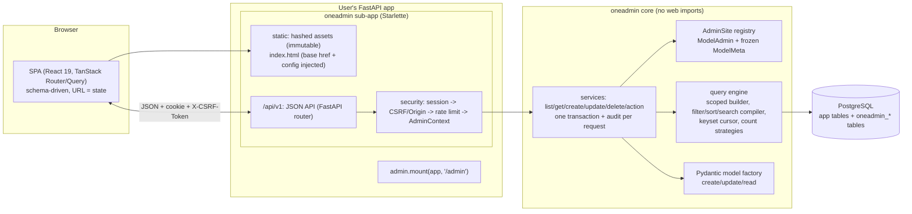
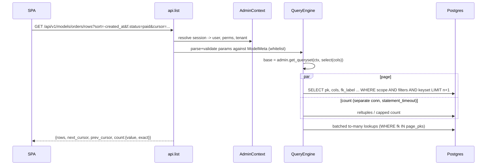

# OneAdmin: master plan

Status: approved direction. Name: **`oneadmin`** (ADR-0014). Milestone order amended by ADR-0015 (pilot integration first, release last) and ADR-0016 (built-in auth before the pilot).

## 1. Vision and positioning

**The admin panel for FastAPI + SQLAlchemy that stays fast at 10M rows and is secure before you configure anything.**

Register models in an `admin.py`, customise them with a Django-style `ModelAdmin`, run `pip install`, and get:
- a fast, accessible, keyboard-first SPA
- real users, roles, sessions and CSRF
- an audit log
- tenant isolation enforced on every code path

No Node is needed on the user's side.

Measurable claims we will prove with checked-in benchmarks before release:
1. **List page cost is independent of table size and page depth.** We assert keyset plans use an `Index Cond` on PG, and benchmark p50/p95 at 1M and 10M rows against sqladmin and Starlette-Admin with the same models and hardware.
2. **List views run a constant number of queries**: 1 + (number of to-many display columns), enforced in CI.
3. **Initial JS ≤ 150 KB gzip.** FastAdmin ships 1.04 MB and Piccolo Admin 323 KB, both measured (landscape.md). Enforced in CI.
4. **Secure by default**: an OWASP-oriented security test suite ships in the repo.

### Non-goals (v1)
> ROADMAP.md (Phase 1, ADR-0020) reopens the plugin, dashboard, upload and i18n non-goals below. Until that ADR is accepted, they stand.

- Other ORMs (Tortoise, Piccolo, SQLModel-specific features beyond what plain SA gives us), and sync SQLAlchemy sessions.
- First-class MySQL. PostgreSQL is first-class; SQLite is supported for development and tests; MySQL is best-effort.
- Third-party frontend plugins or custom JS widgets. Extension happens server-side: fields, formatters, actions, hooks, custom pages declared in the schema.
- Dashboards and charts, i18n (strings are centralised to prepare for it), Redis (the protocol exists, no implementation yet), SSO (the `AuthBackend` protocol exists, only the built-in backend ships), file uploads/storage.
- Server-side rendering, and Jinja templates for end users.

## 2. Architecture



**Package layout and dependency direction** (enforced by an import-linter-style test):

```
oneadmin/
  core/        # metadata, introspection, query engine, pydantic factory, services, AdminContext
               #   imports: sqlalchemy, pydantic. MUST NOT import fastapi/starlette/api/ui
  auth/        # users, sessions, passwords, CSRF primitives, rate limit (core-level, no web)
  api/         # FastAPI router, request parsing, error contract, middleware -> depends on core/auth
  ui/          # static serving, index.html injection -> depends on nothing but starlette
  cli/         # `oneadmin` command (createsuperuser, migrate, check, schema)
  site.py      # AdminSite (public facade: register, mount)
  model_admin.py
```

### Request lifecycle (list)



## 3. Milestones

Each milestone ships on its own: main stays green and the docs are updated with it.

| # | Milestone | Exit criteria |
|---|---|---|
| **M0** | Foundation | uv project, ruff/mypy strict, pytest + testcontainers PG fixture, CI (lint, types, tests, build), hatch build hook proven (wheel contains placeholder `static/index.html`, built from sdist without Node), example models (tenant, user, customer, product, category, tag M2M, order, order line, JSONB, enum), seed script (1M orders) |
| **M1** | Query engine (riskiest) | introspection → frozen `ModelMeta`; filter/sort/search compiler with whitelists; keyset cursors (multi-key, mixed direction, nullable two-phase, composite PK, signed and opaque); count strategies; **plan-shape tests on PG**, query-count tests, NULL/duplicate/unicode/empty edge cases, injection tests; a 1M-row benchmark script with recorded results |
| **M2** | Admin core + read API | `AdminSite`, `ModelAdmin` (list_display, list_filter, search_fields, ordering, list_select_related, readonly, exclude), `AdminContext`, scoped queries on every path, FK label joins, `/api/v1/schema` (versioned), list/detail endpoints, error contract, `admin.mount(app)`, contract snapshots |
| **M3** | Built-in auth + CLI (ADR-0016) | threat model finalised; `oneadmin_*` tables + packaged migrations; `oneadmin migrate / createsuperuser / check`; argon2id off-loop; DB sessions; CSRF + Origin; login rate limit; security headers; security tests |
| **M4** ✓ | Minimal UI | Vite/React/TS shell under any prefix: login, navigation, list (sort, filter, search, cursor pager, counts), detail; built into the wheel by the hook |
| **P1** | **Pilot in `9x/restaurntsaas-backend`** | editable path install on a branch; real models registered; findings in `docs/pilot/`; every bug becomes a regression test here |
| **M5** ✓ | Writes, audit, permissions, actions | Pydantic create/update (extra=forbid, omittable ≠ nullable); one transaction + same-txn audit; optimistic concurrency; per-model grants; bulk actions; mass-assignment tests |
| **M6** ✓ (palette deferred) | UI forms & polish | edit/create widgets, validation errors, conflicts, actions UI, command palette, a11y audit, bundle budget |
| **M7+** | See **[ROADMAP.md](ROADMAP.md)** | Phases 0–6 to 1.0: extensibility core (M7 ✓) → first 5 minutes + PyPI 0.1 (M8) → feature parity (M9) → standout features (M10) → ecosystem (M11) → 1.0 |

Every milestone is dogfooded on `examples/shop` (multi-tenant) and, from P1 on, on the owner's pilot project.

## 4. Risk register

| Risk | L | I | Mitigation |
|---|---|---|---|
| Keyset compiler emits index-hostile predicates | M | H | Plan-shape tests on PG (TF§2); bounded-form compiler |
| Tenant scope bypass on some endpoint (IDOR) | M | **Critical** | Single scoped builder; every endpoint parametrized in a cross-tenant security test; no API path to an unscoped `session.get()` |
| Introspection breaks on exotic models | H | M | Degrade to read-only + startup warning; fixture zoo (composite PK, inheritance, association objects, hybrids, custom types) |
| Frontend scope explodes (solo maintainer) | H | H | Schema-driven, small widget set, no plugin ABI in v1, strict budgets |
| SQLAlchemy 2.0/2.1 typing or behavior differences | M | M | CI matrix on both; avoid private APIs |
| Supply chain (npm) | M | H | pnpm lockfile, `pnpm audit` + `pip-audit` in CI, minimal deps, provenance on release |
| Wheel shipped without UI | L | H | Hook fails loudly; CI asserts wheel contents |
| Count queries slow under filters | M | M | Parallel count with statement timeout; capped counts; "exact" on demand |
| Burnout / maintenance | H | H | Small public API, `__all__`, experimental markers, explicit non-goals |

## 5. Testing strategy and quality gates

- **Unit** (`tests/unit`): compiler output, cursor encoding, Pydantic factory, introspection. SQLite or no DB, fast.
- **Integration** (`tests/integration`): real PG 17 via testcontainers, a session-scoped container with per-test transaction rollback. Plan-shape and query-count assertions live here.
- **Security** (`tests/security`): CSRF, IDOR across tenants, mass assignment, SQLi via filter/sort/search/cursor, XSS payload round-trip (stored safely, rendered as text), brute force, session fixation.
- **Contract**: snapshots of `/schema` and OpenAPI; CI fails if `frontend/src/api/types.gen.ts` is stale.
- **Frontend**: Vitest + Testing Library for units, Playwright for e2e against the example app (login → list → filter → edit → audit), with axe checks.
- **Gates (CI):** ruff, ruff format --check, mypy --strict, pytest (all suites), coverage ≥ 90% on `core/` and `auth/`, Biome + `tsc`, Vitest, Playwright, size budget, wheel content check, `pip-audit`/`pnpm audit`.

## 6. Performance budgets

| Budget | Value | Enforcement |
|---|---|---|
| List queries | 1 + to-many display columns | CI query-count assertions |
| Keyset plan | `Index Cond` on the leading sort key (when indexed) | CI EXPLAIN assertions |
| List p95 at 1M rows (local bench, 50 rows) | target < 15 ms server time | bench script, recorded per release, not a CI gate (noise) |
| Schema endpoint | cached; ETag 304 | test |
| Initial JS | ≤ 150 KB gzip | CI (size-limit) |
| Initial CSS | ≤ 25 KB gzip | CI |
| Lazy chunks (JSON editor) | ≤ 120 KB gzip each | CI |
| LCP on list view (local, cold) | < 1.5 s | Playwright trace, tracked |

## 7. Release strategy

- SemVer, `0.x` until the schema contract is declared stable. The schema contract has its own version (`contract: 1`), checked by the SPA.
- Releases are cut from tags by GitHub Actions: build sdist + wheel once, verify their contents, publish via **PyPI trusted publishing** (OIDC, protected environment, attestations).
- CHANGELOG follows Keep a Changelog. Conventional commits.
- Deprecations get at least one minor release of warnings before removal.
