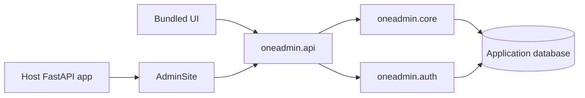

# Architecture and compatibility boundaries

OneAdmin mounts a FastAPI sub-application into the host app. Its Python package ships the compiled React UI. The browser calls OneAdmin's versioned JSON API; OneAdmin uses the host application's async SQLAlchemy session factory to access application tables and its own account, session, and audit tables.

## Source boundaries

| Area | Responsibility |
| --- | --- |
| `site.py` | Public facade, model registration, site-owned state, and mounting. |
| `core/` | Model configuration, query compilation, validation, scoping, operations, and writes. No web-framework imports. |
| `auth/` | Accounts, permissions, sessions, password primitives, and migrations. No web-framework imports. |
| `api/` | HTTP request/response contract and security middleware. Calls core and auth services. |
| `ui/` | Serving the prebuilt frontend under the mount prefix. |
| `cli/` | Site discovery, migrations, diagnostics, and setup commands. |
| `frontend/` | Schema-driven UI. No per-application frontend code is required. |

`tests/unit/test_layering.py` enforces the dependency direction. `ModelAdmin` options compile at startup; request handlers use the compiled description. This keeps misconfiguration errors early and avoids rebuilding model metadata on every request.

## Guarantees to preserve

The detailed invariants are in the repository root's `CLAUDE.md`. Changes to a model operation must preserve these boundaries:

1. A scoped operation calls `ModelAdmin.apply_scope` for every target and related-model lookup.
2. Permissions are checked on the server, including custom and bulk actions.
3. Writes validate allowed fields and use the same transaction for the row change and its audit entry. Updates and deletes use `If-Match` to detect conflicts.
4. List queries retain their bounded keyset behavior where the sort supports it; query-count and PostgreSQL plan tests guard this.
5. API response models are the source for generated frontend types. Schema changes require contract tests and a version decision.

The limitations in [Open questions](OPEN_QUESTIONS.md) are part of the current contract. In particular, custom actions writing other models do not yet receive automatic scoping or auditing. Do not describe that path as protected until the implementation and tests cover it.

## Public surface

`oneadmin.__all__` defines the top-level Python API. The documented `oneadmin.fields` and `oneadmin.conventions` modules also expose extension points. CLI commands, documented configuration options, migrations, and `/api/v1` responses are consumer-facing contracts even when they are not Python imports. Changes to these need docs, tests, a changelog entry, and a compatibility decision. See the [release process](release-process.md).
